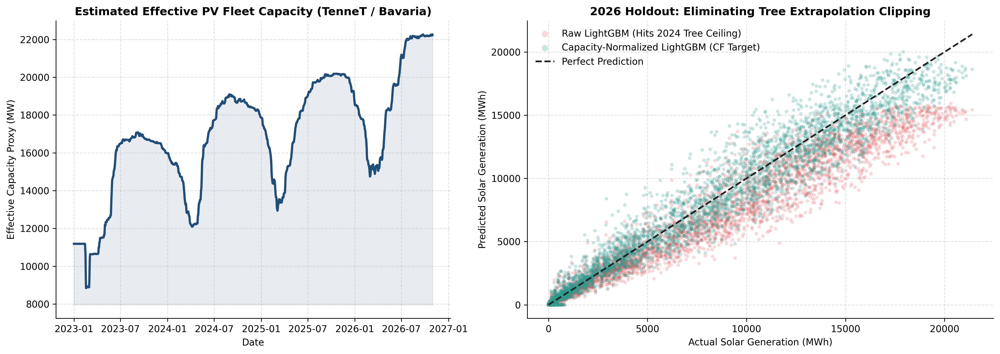
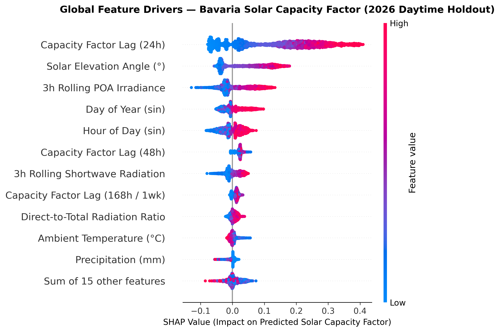
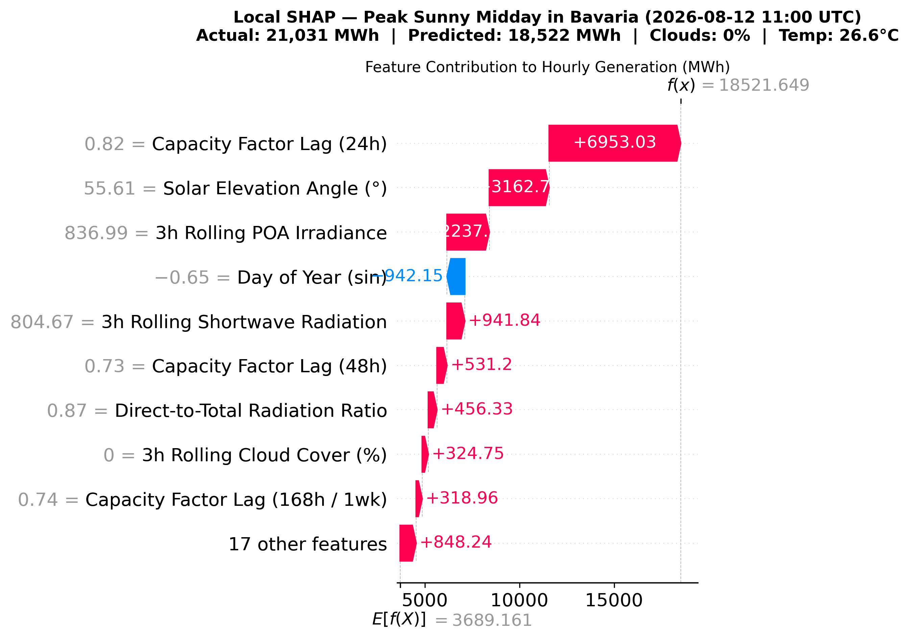
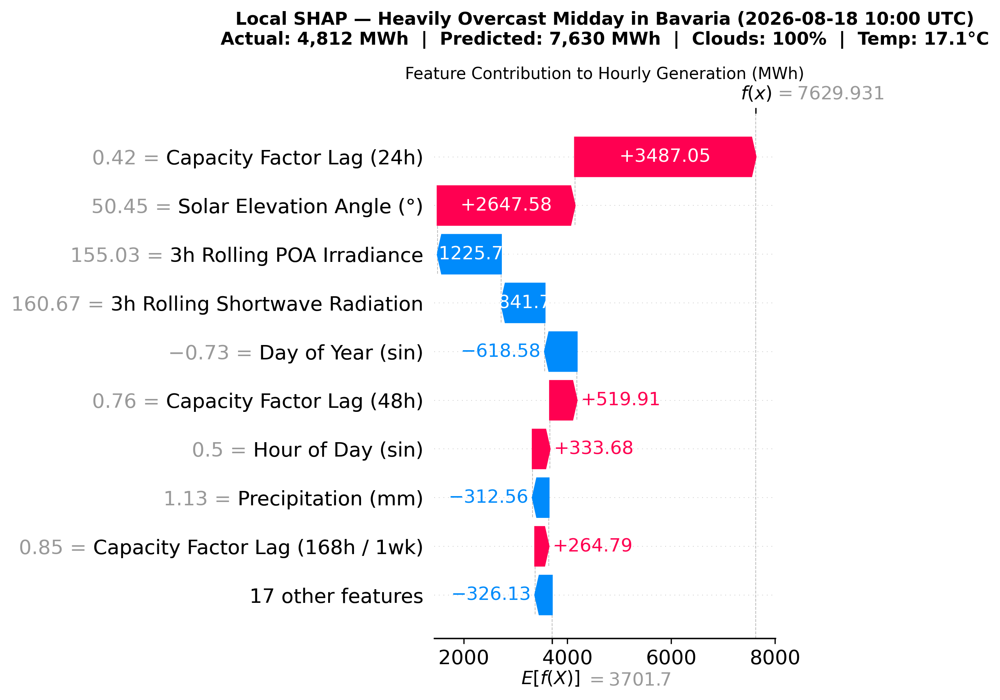

# ☀️ Bavaria Solar Power & Grid Load Forecaster (Physics-Informed ML + SHAP)

An end-to-end, leakage-free **24-hour day-ahead solar PV forecasting system** for Germany's **TenneT / Bavaria** transmission control zone—combining multi-API telemetry fusion, solar array physics, causal fleet capacity normalization, and real-time **TreeSHAP** explainability.

🔗 **[Launch Live Interactive What-If Simulator (Streamlit)](https://bavaria-solar-forecaster.streamlit.app/)**

---

## 📌 Engineering Problem
Bavaria leads Germany in installed photovoltaic (PV) capacity, creating two major forecasting challenges for grid operators:
1. **Weather Volatility:** Passing cloud fronts and heatwave silicon derating cause rapid intra-day swings in solar output.
2. **Non-Stationary Fleet Growth (Tree Extrapolation Ceiling):** Because Bavaria added substantial new solar capacity between 2023 and 2026, standard tree models (like LightGBM) trained on 2023–2024 raw MWh values **cannot extrapolate above historical maxima**—systematically underpredicting 2026 summer peaks.

---

## ⚙️ Key Innovations
* **UTC Multi-Source API Fusion:** Synchronized nearly 4 years (~33,500 hours, 2023–2026) of official Bundesnetzagentur **SMARD.de** TenneT grid telemetry with averaged hourly meteorological & irradiance data across **Munich, Nuremberg, and Würzburg** (Open-Meteo) strictly in UTC to eliminate CET/CEST Daylight Saving Time anomalies.
* **Physics-Informed Feature Engineering:** Computed Bavaria's solar elevation angle, projected direct/diffuse radiation onto a **30° south-facing Plane-of-Array (POA)** tilt, and modeled PV silicon **thermal derating** ($-0.4\% / ^\circ\text{C}$ above $25^\circ\text{C}$ estimated cell temperature).
* **Causal Capacity-Factor Normalization:** Estimated effective regional PV fleet capacity using strictly past clear-sky observations (shifted $\ge 24\text{h}$ to prevent leakage), trained LightGBM on stationary **Capacity Factor** (`solar_cf`), and scaled predictions back to MWh—eliminating tree peak clipping.
* **Leakage-Free Chronological Validation:** Strictly separated time periods (**2023–2024 Train → 2025 Validation → 2026 Unseen Holdout Test**) with all target lags constrained to $\ge 24\text{h}$ prior.
* **Real-Time TreeSHAP Explainability:** Deployed an interactive Streamlit What-If simulator where adjusting date, local hour, cloud cover, temperature, or future fleet capacity generates a live 24-hour solar curve and an exact **MWh SHAP waterfall explanation**.

---

## 📊 2026 Unseen Holdout Benchmark

| Model | Overall MAE (MWh) | Daytime MAE (MWh) | Top-10% Peak MAE (MWh) | RMSE (MWh) | $R^2$ |
| :--- | :---: | :---: | :---: | :---: | :---: |
| 1. Seasonal Naive (24h Lag) | 917.5 | 1,709.4 | 1,976.1 | 1,830.8 | 0.8990 |
| 2. Ridge Regression (Linear) | 730.6 | 1,352.3 | 2,602.7 | 1,319.5 | 0.9475 |
| 3. LightGBM (Raw MWh Target) | 856.8 | 1,594.3 | 3,909.2 | 1,593.0 | 0.9235 |
| **4. LightGBM (Capacity-Normalized CF)** | **558.6** | **1,031.1** | **1,613.9** | **1,047.8** | **0.9669** |

### Key Takeaways
* **Why Raw Trees Fail on Growing Grids:** Because installed PV capacity expanded after 2024, raw LightGBM actually trailed linear Ridge Regression overall (856.8 vs. 730.6 MWh MAE) and suffered severe clipping on peak hours (3,909.2 MWh Top-10% Peak MAE).
* **Impact of Capacity Normalization:** Decomposing the target into causal fleet capacity $\times$ stationary capacity factor cut LightGBM's **Top-10% Peak MAE by 59%** (3,909.2 → 1,613.9 MWh), reduced **Overall MAE by 35%** (856.8 → 558.6 MWh), and beat the 24h seasonal naive baseline by **39%**.

---

## 🔍 Visual Highlights

### Solving Tree Extrapolation Clipping on 2026 Summer Peaks


### Global Feature Drivers (2026 Daytime TreeSHAP Beeswarm)


### Local Explanations: Clear Summer Midday vs. Heavily Overcast Midday



---

## 📁 Repository Structure
```text
bavaria-solar-forecaster/
├── app.py                                 # Interactive Streamlit What-If Simulator & SHAP app
├── lgbm_bavaria_solar_cf.joblib           # Serialized capacity-normalized LightGBM model
├── bavaria_solar_test_comparison_2026.csv # Unseen 2026 holdout benchmark predictions
├── notebooks/
│   └── bavaria_solar_forecasting.ipynb    # Full Colab ingestion, physics, training & SHAP notebook
├── images/                                # Exported diagnostic & SHAP PNG charts
├── requirements.txt
├── packages.txt                           # System OpenMP library (libgomp1) for LightGBM
└── README.md
```
---

## 🚀 How to Run Locally
```bash
git clone [https://github.com/LeaderTrusty/bavaria-solar-forecaster.git](https://github.com/LeaderTrusty/bavaria-solar-forecaster.git)
cd Solar-Power_Forcasting
pip install -r requirements.txt
streamlit run app.py
```
---

## 📂 Data Sources & Licenses
* **Grid Generation & Load Telemetry:** Bundesnetzagentur | [SMARD.de](https://www.smard.de/) (TenneT Control Zone, licensed under **CC BY 4.0**).
* **Historical Meteorological & Irradiance Data:** [Open-Meteo Historical Weather API](https://open-meteo.com/) (ERA5 / DWD reanalysis archive, licensed under **CC BY 4.0**).
